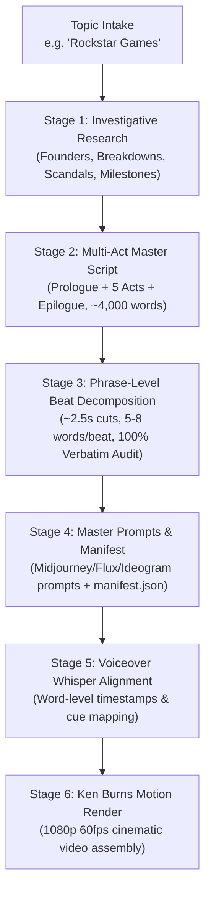

# Entire History Documentary Video Engine (HISTROY-VID)

[](https://opensource.org/licenses/MIT)
[](https://www.python.org/downloads/)
[](https://ffmpeg.org/)

An automated, hyper-retention production pipeline designed to create **20-to-30 minute investigative company and cultural documentaries** (e.g., *The Entire History of Rockstar Games*, *The Entire History of Apple*, *The Entire History of Sony PlayStation*).

---

## 🚀 Key Innovations & Standards

* **Phrase-Level Micro-Beat Pacing**: Every cut is strictly locked to **2.0s – 3.2s** (~5 to 8 words per cut), eliminating scene stagnation and visual drag.
* **100% Verbatim Script Verification**: Automated character-by-character string matching guarantees zero dropped or altered words between the voiceover and image breakdown.
* **Style 4 Line-Art Aesthetic**: Minimalist white-filled character heads, expressive line limbs, muted charcoal/watercolor vignette backgrounds (`#FAF9F6`), and saturated focal accents.
* **In-Image Graphic Badges**: Stamped with exact spoken figures, shock words, or dates (`[$800,000,000]`, `[100 HOURS]`, `[AO RATED]`) for instant multisensory lock.
* **Zero-Drift Whisper Alignment**: Word-level acoustic timestamp alignment mapped directly to video cut windows.

---

## 📂 Repository Structure

```text
HISTROY-VID/
├── companies/
│   ├── apple/                       # Apple Documentary Suite (Script, Cues, Prompts, Manifest)
│   ├── rockstar_games/              # Rockstar Games & GTA Suite (592 Beats, Prompts, Manifest)
│   └── sony_playstation/            # Sony PlayStation Suite (Script, Prompts, Manifest)
├── pipeline/
│   ├── history_researcher.py        # Stage 1: Investigative Research Framework
│   ├── documentary_scripter.py      # Stage 2: Multi-Act High-Retention Script Engine
│   ├── beat_decomposer.py           # Stage 3: Phrase-Level Beat Breakdown & Verbatim Verification
│   ├── prompt_builder.py            # Stage 4: Midjourney/Flux Prompt & Manifest Builder
│   ├── whisper_aligner.py           # Stage 5: Whisper Audio Alignment
│   └── motion_renderer.py           # Stage 6: FFmpeg Ken Burns 1080p Motion Renderer
├── run_history_pipeline.py          # Unified Master CLI Orchestrator
├── requirements.txt                 # Python dependencies
└── README.md
```

---

## 🛠️ End-to-End Workflow: From Topic Intake to Final Render



### 1. Step 1: Research Intake
Generate a 7-pillar investigative framework for any new company:
```bash
python run_history_pipeline.py --topic "Nintendo" --step research
```

### 2. Step 2: Audit & Validate Multi-Act Script
Verify paragraph structure, word counts, and estimated runtime:
```bash
python run_history_pipeline.py --topic "Rockstar Games" --step script
```

### 3. Step 3: Decompose into Micro-Beats
Break down the script into ~2.5s phrase-level visual beats and verify 100% verbatim parity:
```bash
python run_history_pipeline.py --topic "Rockstar Games" --step beats
```

### 4. Step 4: Generate Prompts & Manifest
Compile the complete ready-to-copy prompt package (`master_prompts.txt`) and automated manifest:
```bash
python run_history_pipeline.py --topic "Rockstar Games" --step prompts
```

### 5. Step 5: Audio Alignment
Align master voiceover (`voiceover_master.mp3`) with Whisper word timestamps:
```bash
python run_history_pipeline.py --topic "Rockstar Games" --step align
```

### 6. Step 6: Render Documentary Video
Render high-definition Ken Burns motion video using FFmpeg:
```bash
python run_history_pipeline.py --topic "Rockstar Games" --step render
```

Or run the complete pipeline in one go:
```bash
python run_history_pipeline.py --topic "Rockstar Games" --step all
```

---

## 🎬 Current Production Documentaries

| Topic | Word Count | Scenes / Cuts | Avg Duration / Cut | Status |
| :--- | :---: | :---: | :---: | :---: |
| **Rockstar Games & GTA** | 3,894 words | **592 scenes** | **2.73s** | Prompts & Manifest Complete |
| **The Entire History of Apple** | 4,200 words | **439 scenes** | **2.85s** | Master Motion Aligned |
| **Sony PlayStation** | 4,800 words | **420 scenes** | **2.95s** | Prompts & Manifest Complete |

---

## 📄 License
MIT License. Created for high-retention documentary creators.
